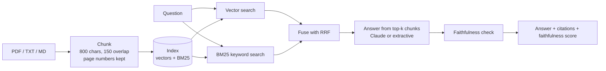

# rag-docs-chat

[](https://github.com/techsaurabh-394/rag-docs-chat/stargazers) [](LICENSE) [](https://github.com/techsaurabh-394/rag-docs-chat/commits/main) [](https://github.com/techsaurabh-394/rag-docs-chat/issues) [](https://buymeacoffee.com/saurabhdev)

Upload PDFs or text files, ask questions, and get answers that **cite the exact source passage** (document, page and snippet). Retrieval is **hybrid** (BM25 plus vectors), and every answer gets a **faithfulness check** that flags sentences the cited passages do not support.

It is a small, readable RAG app: about 500 lines of Python, no vector database, and no API key needed to try it.

> New to RAG? Read [what RAG is](#what-is-rag) below, or follow the full step-by-step course: [ai-engineer-roadmap, Phase 1 · RAG Foundations](https://github.com/techsaurabh-394/ai-engineer-roadmap/tree/main/01-rag-foundations).

## What is RAG?
A language model only knows what it was trained on. It has not seen your PDFs. **RAG (Retrieval-Augmented Generation)** fixes that in two steps: first *retrieve* the few passages most relevant to the question, then *generate* an answer from only those passages, with citations. That makes answers checkable and cuts down on made-up facts.

## How it works



| Piece | File | Notes |
|---|---|---|
| Chunking | `app/chunking.py` | Sentence-aware, about 800 chars, 150 overlap, page numbers preserved |
| Vector retrieval | `app/embeddings.py` | `local`: hashed TF-IDF (numpy only, offline). `dense`: sentence-transformers |
| Keyword retrieval | `app/bm25.py` | Dependency-free BM25 (k1=1.5, b=0.75) |
| Fusion and answering | `app/rag.py` | Reciprocal Rank Fusion (k=60), grounded prompt, extractive fallback |
| Faithfulness | `app/faithfulness.py` | Lexical support check per sentence (see limits below) |
| API | `app/main.py` | FastAPI: `/api/upload`, `/api/ask`, `/api/docs` |
| UI | `app/static/index.html` | Single-file vanilla JS, shows unsupported sentences |
| Evaluation | `eval/run_eval.py` | hit@1, hit@3 and MRR for each retrieval mode |

### Retrieval modes
| Mode | What it does | Good at |
|---|---|---|
| `local` | Vector search only | Loose matches |
| `bm25` | Keyword search only | Exact terms, error codes, names |
| `hybrid` (default) | BM25 + vectors fused with RRF | Both; safest default |

### Two answer modes
- **With `ANTHROPIC_API_KEY`:** Claude writes the answer from the retrieved passages and cites sources. If the passages do not contain the answer, it says so.
- **Without a key:** extractive mode returns the best passage with its citation. The whole app runs with no key and no model downloads.

## Run it
```bash
git clone https://github.com/techsaurabh-394/rag-docs-chat.git
cd rag-docs-chat
python -m venv .venv && source .venv/bin/activate     # Windows: .venv\Scripts\activate
pip install -r requirements.txt
cp .env.example .env                                  # optional: add ANTHROPIC_API_KEY
uvicorn app.main:app --reload
```
Open http://localhost:8000, upload a document and ask a question.

Environment variables are read from the shell. To load `.env`, run `export $(grep -v '^#' .env | xargs)` first.

**Dense embeddings** (better semantic matching):
```bash
pip install sentence-transformers
EMBEDDER=dense uvicorn app.main:app
```

**Docker:**
```bash
docker build -t rag-docs-chat .
docker run -p 8000:8000 -e ANTHROPIC_API_KEY=your_key rag-docs-chat
```

## Configuration
| Variable | Default | Meaning |
|---|---|---|
| `ANTHROPIC_API_KEY` | unset | If set, Claude writes answers. If unset, extractive mode |
| `ANTHROPIC_MODEL` | `claude-sonnet-5-5` | Model used when a key is set |
| `EMBEDDER` | `local` | `local` (hashed TF-IDF) or `dense` (sentence-transformers) |
| `RETRIEVAL` | `hybrid` | `local`, `bm25` or `hybrid` |
| `INDEX_PATH` | `data/index.json` | Where the index is saved |

## API
```bash
# Upload a document
curl -F "file=@notes.pdf" http://localhost:8000/api/upload

# Ask a question (mode is optional: local | bm25 | hybrid)
curl -X POST http://localhost:8000/api/ask \
  -H "Content-Type: application/json" \
  -d '{"question": "Where should refresh tokens be stored?", "k": 4, "mode": "hybrid"}'

# List and delete documents
curl http://localhost:8000/api/docs
```
The `/api/ask` response contains `answer`, `mode`, `sources` (document, page, snippet) and `faithfulness` (an overall score plus a support score for each sentence).

## Evaluate retrieval
```bash
python -m eval.run_eval --mode all          # compare local, bm25 and hybrid
python -m eval.run_eval --mode hybrid --verbose
python -m eval.run_eval --dense             # use sentence-transformers
```
A chunk counts as a hit when it comes from the expected document and contains the expected phrase.

**Measured results** (bundled set: 18 questions, 3 documents, 6 chunks, local embedder, k=5):

| mode | hit@1 | hit@3 | MRR |
|---|---|---|---|
| local | 0.67 | 0.89 | 0.769 |
| bm25 | 0.72 | 0.89 | 0.819 |
| hybrid | 0.72 | 0.89 | 0.819 |

Read this honestly. The set is tiny, so one question moves a score by about 0.06, and hybrid only ties BM25 here. Two paraphrased questions miss in every mode, because their words do not appear in the passage; that is the case dense embeddings or a reranker are for. To get a number you can trust, put your own documents in `eval/corpus/` and add question/phrase pairs to `eval/questions.jsonl`.

## Faithfulness check: what it is and is not
Each answer sentence is compared with the passages it cites. A sentence counts as supported when at least 60% of its content words appear in a cited passage. The overall score is the mean.

This is a **cheap lexical heuristic, not an LLM judge**. It catches sentences about things missing from the sources (new names, numbers, topics). It cannot catch a sentence that reuses the right words but says something false, such as a negation. It can also flag a correct paraphrase. Use it as a warning light, not as proof.

## Tests
```bash
pip install -r requirements-dev.txt
pytest -q          # 30 tests: chunking, BM25, RRF, all modes, faithfulness, API with no key
```
CI runs the tests and the evaluation on every push.

## Troubleshooting
| Problem | Fix |
|---|---|
| Scanned PDF returns no text | It has no text layer. Run OCR first |
| Answers ignore a rare word or code | Use `hybrid` or `bm25` mode |
| Paraphrased question finds nothing | Use `EMBEDDER=dense` |
| `File too large (20 MB max)` | Split the file. The limit is 20 MB per upload |
| Faithfulness warns on a correct answer | The check is lexical. Read the cited passage |

## Limits and next steps
- The index is rebuilt on every upload. That is fine for tens of documents. For larger collections, use a vector database (pgvector, Qdrant) and incremental indexing.
- Ideas: a reranker, streaming answers, an LLM-based faithfulness judge. See [Advanced RAG](https://github.com/techsaurabh-394/ai-engineer-roadmap/tree/main/02-advanced-rag) for how each works.

## Roadmap (contributions welcome)
- [x] Hybrid retrieval (BM25 + dense)
- [x] Answer-faithfulness check
- [ ] Reranker (cross-encoder)
- [ ] Streaming answers in the UI
- [ ] pgvector / Qdrant backend
- [ ] OCR fallback for scanned PDFs

## License
MIT, built by Saurabh Pathak.

## Support this project
If this is useful, a star helps others find it, and you can support more free open-source work:

<a href="https://buymeacoffee.com/saurabhdev"></a>

---

<p align="center">
  <b>Saurabh Pathak</b> · AI Engineer &amp; Full-Stack Developer<br/>
  <a href="https://github.com/techsaurabh-394">GitHub</a> ·
  <a href="https://www.linkedin.com/in/tech-saurabh/">LinkedIn</a> ·
  <a href="https://mernstackdev.com">Blog</a> ·
  <a href="mailto:saurabhpathak394@gmail.com">saurabhpathak394@gmail.com</a>
</p>
